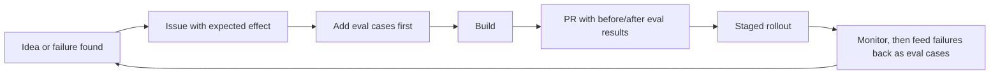

# Team operating model

How a team of four to eight engineers runs AI features day to day. The design goal: quality
and cost problems surface in a weekly meeting, not in a customer complaint.

## Ownership

Every AI feature has one **owner** (an engineer, not the manager) accountable for its
quality, cost and incidents. The owner decides what to fix next within the roadmap, and
presents the feature at the evaluation review.

## Rituals

| Ritual | Cadence | Length | Purpose |
|---|---|---|---|
| **Evaluation review** | Weekly | 30 min | Each owner shows eval results and 2-3 real failures from the week. Decide what to fix. The most important meeting of the week |
| Planning | Every 2 weeks | 45 min | Commit to work against the roadmap; every AI change item names its evaluation |
| Stand-up (async) | Daily | Written | Progress and blockers in the team channel; synchronous only when blocked |
| Demo | Every 2 weeks | 30 min | Show shipped work to stakeholders, including what *didn't* work |
| Retrospective | Monthly | 45 min | Process improvements; one action item with an owner |
| 1:1s | Weekly | 30 min | The engineer's agenda first: growth, blockers, feedback both ways |
| Incident review | After each incident | 45 min | Blameless [postmortem](https://github.com/tsriharsha402/ai-delivery-playbook/blob/main/templates/09-incident-postmortem.md) |

## How work flows

**Rule of thumb:** a failure found in production becomes an evaluation case before it
becomes a fix. The eval set grows from real failures, and the same bug can't come back
unnoticed.

## Quality gates

- Every model, prompt or retrieval change: evaluation results in the PR; blocking
  thresholds can't regress.
- Every launch: the [launch readiness](https://github.com/tsriharsha402/ai-delivery-playbook/blob/main/templates/07-launch-readiness.md) review.
- Quarterly: re-run model selection for the most expensive feature.

## On-call

- One primary and one secondary, weekly rotation; new engineers join after day 90.
- AI-specific runbooks: provider outage, cost spike, sudden change in abstention or
  refusal rate, prompt injection report.
- Any week with more than three night pages earns a day off and triggers an alert review.

## Decision making

| Decision | Who decides | How |
|---|---|---|
| Implementation details | Engineer | PR review |
| Design choices within a feature | Feature owner | [Decision record](https://github.com/tsriharsha402/ai-delivery-playbook/blob/main/templates/05-decision-record.md), reviewed by one peer |
| Model or vendor change | Feature owner + manager | Evaluation evidence; pre-registered decision rule |
| Launch go/no-go | Manager | Launch readiness review |
| Roadmap priorities | Manager + product | Quarterly, with team input |

Disagreements are resolved with evidence when possible (run the eval) and by the named
decider when not. Once decided, the team commits; the decision record keeps the dissent.
